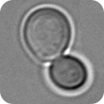
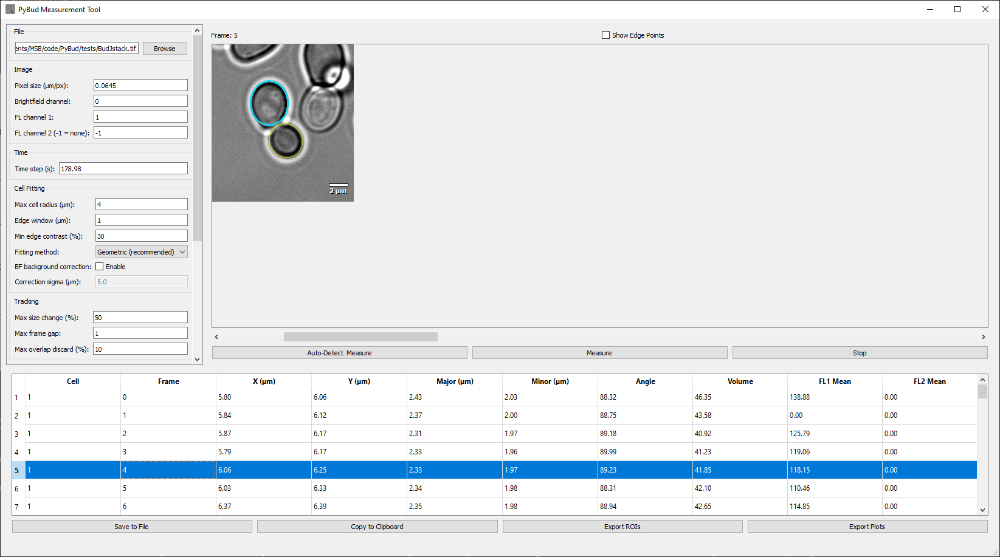
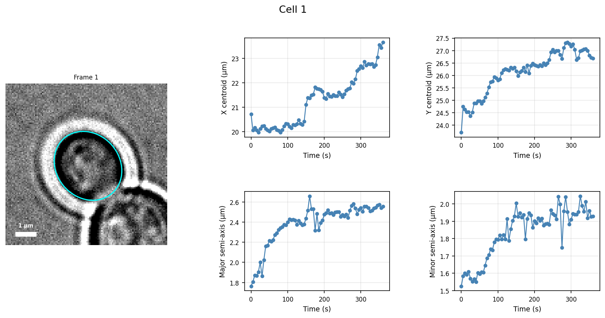
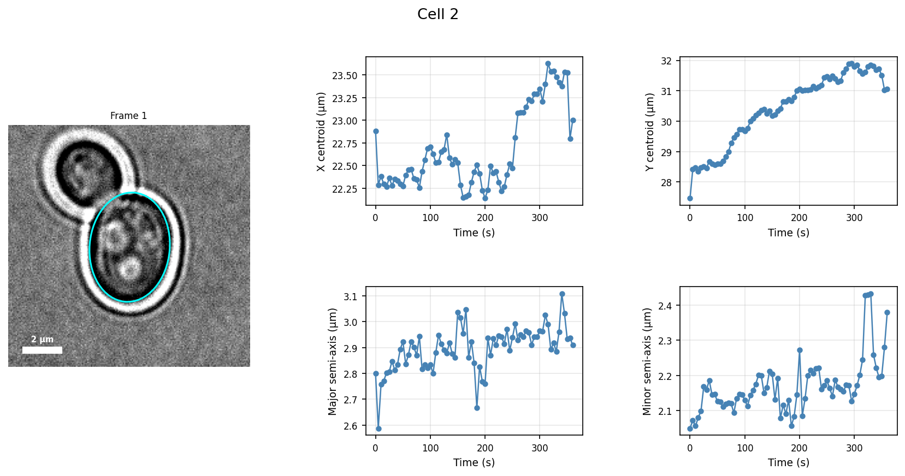

#  PyBud — Cell Tracking & Measurement Tool

PyBud is a Python tool for tracking and measuring yeast cells in brightfield time-lapse microscopy. It fits ellipses to cell boundaries frame-by-frame using radial edge detection, links detections into tracks across frames, and exports quantitative measurements alongside publication-quality plots. It is inspired by the BudJ ImageJ plugin but is fully written in Python and does not require ImageJ or Z-stacks.

> BudJ: Ferrezuelo F, Colomina N, Palmisano A, Garí E, Gallego C, Csikász-Nagy A, Aldea M. "The critical size is set at a single-cell level by growth rate to attain homeostasis and adaptation." *Nat Commun.* 2012;3:1012. doi:10.1038/ncomms2015.

---

## Table of Contents

1. [Installation](#installation)
2. [Quick Start](#quick-start)
3. [Interface Overview](#interface-overview)
4. [Parameter Reference](#parameter-reference)
5. [Workflows](#workflows)
6. [Results Table](#results-table)
7. [Exporting Data](#exporting-data)
8. [Command-Line Interface](#command-line-interface)
9. [Tips & Troubleshooting](#tips--troubleshooting)
10. [API Reference](#api-reference)

---

## Installation

### Requirements

Python 3.8 or later. Install dependencies with pip:

```
pip install PyQt5 numpy scipy scikit-image tifffile roifile matplotlib openpyxl pandas
```

### Getting started

Clone the repository and launch the GUI:

```bash
git clone https://github.com/molecular-systems-biology/PyBud.git
cd PyBud
python pybud_gui.py
```

### Project layout

```
PyBud/
├── pybud/                  # importable Python package (tracking engine)
│   ├── tracker.py          # PyBud tracking engine
│   ├── autodetect.py       # AutoDetect — Hough-based cell detection
│   ├── plots.py            # Plots — figure export
│   ├── cell.py             # Cell — per-frame measurement
│   ├── ellipse.py          # Ellipse — boundary fitting
│   └── fluorescence.py     # Fluorescence — channel statistics
├── gui/                    # PyQt5 GUI implementation, by responsibility
│   ├── state.py             # the shared PyBud instance
│   ├── columns.py           # results-table column definitions
│   ├── workers.py           # QThread workers (tracking, FL offset, TIF load)
│   ├── dialogs.py           # ColumnSettingsDialog, ExportPlotsDialog
│   ├── help_dialog.py        # HelpDialog
│   ├── image_viewer.py        # ContrastHistogram, ClickableImageLabel, ImageViewer
│   ├── settings_panel.py      # Settings
│   ├── measurement_table.py   # MeasurementTable
│   └── main_window.py          # MainWindow
├── pybud_gui.py            # GUI entry point (run this to launch the app)
├── autotrack.py            # command-line pipeline
├── tests/                  # example scripts and small test data
└── images/                 # screenshots and example output figures
```

---

## Quick Start

1. Click **Browse** and open a multi-channel, multi-frame `.tif` file (a progress bar shows load progress for large movies). Pixel size and time step are auto-populated from the file metadata when available.
2. Check that the **Image** parameters (pixel size, channel indices) are correct. There's no separate "apply" step — these take effect automatically the moment you click Measure, an Auto-Detect button, or Re-fit Frame Range.
3. **Left-click** on a cell in the image to place a seed point (green cross). Seeds can be placed on any frame; PyBud tracks forward from that frame automatically.
4. Click **Measure**. Fitted ellipses appear in yellow; the results table populates with per-frame measurements.
5. Click **Export Plots** to save a time-series figure for each tracked cell.

---

## Interface Overview



The window is divided into three areas:

| Area | Description |
|---|---|
| **Left panel** | All parameters, grouped by function. Scrollable when the panel is narrow. |
| **Image panel** | Brightfield (or fluorescence) image with fitted ellipses, scale bar, and frame navigation. |
| **Results table** | Per-frame measurements for all tracked cells, accumulated across runs. Click any row to jump to that frame. |

### Image panel controls

| Action | Effect |
|---|---|
| Left-click the image (unfocused) | Focus the image panel for keyboard shortcuts (shown by a blue border), without placing/removing a seed |
| Left-click on cell (focused) | Place a seed point (green cross), labelled with the cell number it will get once measured |
| Left-click on existing cross (focused) | Remove that seed |
| Space + arrow keys (focused) | Hold Space (cursor becomes an open hand) and press an arrow key to pan the view in that direction, instead of stepping frame/channel — handy when zoomed in (same as Ctrl + arrow keys below, just under Space instead) |
| Left / Right arrow | Previous / next frame |
| Up / Down arrow | Previous / next channel |
| Alt + Up / Down arrow | Previous / next channel (matches Alt + scroll wheel) |
| Ctrl + arrow keys | Scroll the image in that direction (handy when zoomed in) |
| Alt + scroll wheel | Previous / next channel |
| Ctrl + scroll wheel | Zoom in/out, centred on the cursor |
| + / − keys | Zoom in / out |
| **−** / **+** / **Reset Zoom** buttons | Zoom out, zoom in, or reset to 100% (current level shown as a percentage between the buttons) |
| Scrollbar | Navigate through frames |
| Channel dropdown | Switch between every channel in the loaded image, for viewing — "Brightfield" and "FL Channel 1/2" are whichever channels are assigned those roles in Settings, any others (e.g. an extra brightfield slice at a different focus depth, or an unassigned fluorescence channel) show as "Channel N". Purely a display choice — doesn't change which channels are actually measured |
| Hover over the image | Shows the raw pixel value under the cursor (current frame/channel) next to the frame counter |
| **Help** button | Opens a reference covering every control, button, and settings parameter |

These shortcuts work from anywhere in the image panel (the image itself, the channel dropdown, the zoom buttons, etc.) — not just when the image is directly focused — while text fields keep their normal typing behaviour.

### Contrast

Click **▸ Adjust Contrast** (below the frame counter) to reveal a histogram of the current frame's pixel-value distribution (log-scaled, like ImageJ's Brightness/Contrast dialog), plus **Min**/**Max** fields and an **Auto** button; click it again to hide them. Drag the green grip triangle to set the display black-point or the red one for the white-point (the cursor becomes a resize arrow when you're over one), or type exact values into **Min**/**Max**. **Auto** re-stretches to the channel's 0.5–99.5 percentile range. This is a display-only adjustment — it's stored per channel and never affects measurements, which always read the raw pixel data.

The current **frame number** is shown above the image. A **scale bar** is shown in the bottom-right corner and updates automatically when zooming (toggle it via **Advanced Settings → Show Scale Bar**, on by default). An **orange dashed line** connects a mother cell to its bud whenever both are visible in the same frame. If a tracked cell is lost partway through (e.g. it drifts out of the search radius or the edge contrast drops too low), a message naming the cell and the frame it was lost on appears in the status bar once fitting finishes. A progress bar appears at the right of the status bar while Measure/Auto-Detect/Re-fit is running, showing how many of the total frames across all active seeds have been processed — most useful when tracking many seed points at once.

### Clicking a row in the table

Click any row to jump the image to that frame, pan the view to that cell's position (if zoomed in), and highlight its ellipse in **cyan** (all other fitted cells remain yellow); arrow keys in the table do the same. Ctrl/shift-click to select multiple rows at once, e.g. before using **Delete Selected Rows**.

### Correcting a shifted fluorescence channel

Some setups (a second camera, a dichroic/filter cube switch) introduce a small, fixed pixel misalignment between the brightfield channel and a fluorescence channel, so the brightfield-fitted outline doesn't sit exactly over the fluorescent signal. Open **Advanced Settings → FL Channel Offset** — each enabled FL channel gets its own X/Y/Auto row there, independent of whichever channel happens to be displayed in the image panel (so switching channels never moves anything on screen):

1. Run **Measure** (or **Auto-Detect + Measure**) at least once, so there are fitted cell outlines to compare against.
2. Click **Auto** on the affected channel's row. PyBud tries small pixel shifts and picks the one that best lines up the already-fitted outlines with that channel's actual signal (by maximising inside-vs-outside intensity contrast, averaged over a sample of fitted cells), then fills in the **X**/**Y** fields.
3. Click **Measure** (or **Re-fit Frame Range**) again — the offset only affects *newly* fitted cells, so this step actually applies the correction to the measurements.

The X/Y fields can also be set by hand if you already know the shift, or to fine-tune the automatic estimate. Once an offset is non-zero, switching the image panel to that channel overlays the as-sampled, shifted outline at full strength (the region fluorescence is actually measured from) plus the original brightfield-fitted outline faintly, as a reference, so you can check the correction visually. The offset is purely about *where to sample* each fluorescence channel — it never changes the fitted outline shape itself, is independent per channel, and (like other settings) round-trips through **Export Settings** / **Import Settings**.

---

## Parameter Reference

### File

| Field | Description |
|---|---|
| File | Path to the `.tif` image stack. Use **Browse** to open. Pixel size and time step are read from the file metadata automatically. |

### Image

| Field | Default | Description |
|---|---|---|
| Pixel size (µm/px) | 0.0645 | Physical size of one pixel in micrometres. Auto-read from TIF metadata (OME-XML, ImageJ tags, or TIFF XResolution). |
| Brightfield channel | 0 | Zero-based channel index used for edge detection. |
| FL channel 1 | 1 | First fluorescence channel. Mean intensity inside the fitted ellipse is measured. Set to −1 to disable. |
| FL channel 2 | −1 | Second fluorescence channel. Set to −1 to disable. |

If a fluorescence channel is spatially shifted relative to the brightfield outline (e.g. a second camera or filter cube), see [Correcting a shifted fluorescence channel](#correcting-a-shifted-fluorescence-channel) — the per-channel pixel offset is set via **Advanced Settings → FL Channel Offset**, not here.

### Time

| Field | Default | Description |
|---|---|---|
| Time step (s) | 1.0 | Time between frames in seconds. Used as the X-axis in exported plots. Auto-read from TIF metadata when available. |

### Cell Fitting

| Field | Default | Description |
|---|---|---|
| Max cell radius (µm) | 4 | Maximum expected cell radius. Radial intensity profiles are sampled out to this distance from the seed point. The pixel count shown next to the field (based on the current pixel size) is what the algorithm actually uses internally. |
| Tracking search radius (µm) | *(blank = same as above)* | Per-frame search radius used while tracking an already-found cell, independent of **Max cell radius**. A smaller value tightens the search window around the previous frame's position, which can reduce false-positive edges from neighbouring cells or debris in a cluttered image — but it also caps how far the edge detector can look, so don't set it smaller than the cell's actual radius. |
| Edge window (µm) | 1 | Width of the sliding window used to detect the dark→bright transition at the cell wall. |
| Min edge contrast (%) | 30 | Minimum contrast relative to the image background for an edge to be accepted. Increase if false edges appear inside the cell. |
| Fitting method | Geometric | **Geometric** — non-linear least-squares fit (more accurate, recommended). **Algebraic** — direct linear fit (faster, less robust for imperfect edges). |
| BF background correction | off | Subtracts a Gaussian background from the brightfield channel before edge detection. Useful for uneven illumination. |
| Correction sigma (µm) | 5.0 | Spatial scale of the Gaussian background estimate. Should be larger than the cell diameter. |
| Allow cell radius growth over time | off | **Off by default**, matching BudJ (which doesn't model this). When on, the two fields below widen the per-frame search radius as a budding cell grows, so tracking doesn't lose a cell that outgrows **Max cell radius** partway through the movie. When off, both are fixed at 0 (disabled) regardless of what's typed into them. |
| Max cell radius increase (%) | 50 | Maximum permitted change in major or minor axis between consecutive frames. Detections exceeding this are treated as missed frames. |
| Max cell radius increase per frame (%) | 5 | How much a budding cell is allowed to grow each frame. Widens the per-frame search radius beyond **Max cell radius** as the cell gets bigger. |

### Display (under Advanced Settings)

| Field | Default | Description |
|---|---|---|
| Show Scale Bar | on | Show the scale bar in the bottom-right corner of the image. |
| Show Masks | on | Fitted-ellipse outlines. Turn off to see raw edge points without the mask drawn over them. |
| Show Edge Points | off | Overlay the raw detected boundary points (red dots) used to fit each cell's ellipse. |

### FL Channel Offset (under Advanced Settings)

| Field | Default | Description |
|---|---|---|
| FL1/FL2 Offset (px) — X / Y | 0, 0 | Per-channel pixel offset correcting a fixed misalignment between that channel and the brightfield-fitted outline. Shown once that channel is enabled, independent of which channel is currently displayed. See [Correcting a shifted fluorescence channel](#correcting-a-shifted-fluorescence-channel). |
| Auto | — | Estimates the offset from already-fitted cells. |

### Tracking (under Advanced Settings)

| Field | Default | Description |
|---|---|---|
| Max frame gap | 1 | Consecutive missed frames tolerated before a track terminates. Missed frames are filled by linear interpolation (shown as open markers in exported plots). |
| Max overlap discard (%) | 10 | If two fitted ellipses in the same frame overlap by more than this fraction of the smaller ellipse's area, the one with the higher track ID is discarded. |

### Auto-Detection (Hough, under Advanced Settings)

Used only by **Auto-Detect + Measure**. Has no effect on plain **Measure**.

| Field | Default | Description |
|---|---|---|
| Min cell radius (µm) | 1.5 | Minimum radius searched by the circular Hough transform. |
| Max cell radius (µm) | 4.0 | Maximum radius searched by the circular Hough transform. |
| Max cells per frame | 10 | Upper limit on candidate circles per frame. Set this to the expected number of cells to reduce false positives. |
| Detection threshold (0–1) | 0.5 | Minimum Hough accumulator score. Increase toward 1.0 to accept only strong, well-defined circles. |
| Match distance (µm) | 8.0 | A candidate is linked to an existing track if its centroid is within this distance of the track's last known position. |

### Mother-Daughter (Bud) Detection

After every fitting run PyBud automatically checks whether any track originated as a bud from an existing cell. Two criteria must both be satisfied at the frame where the daughter first appears:

1. **Proximity** — the daughter's centroid is within `(r_mother + r_daughter) × bud_distance_factor` of the mother's centroid.
2. **Size** — the daughter is smaller than `r_mother × bud_size_ratio`.

The closest qualifying candidate is recorded as the mother. Results appear as an **orange dashed line** connecting centroids in the image. The **Mother Cell** column in the results table (disabled by default; enable via **Output Column Settings**) shows the mother's track ID, or `—` if none was found.

| Field | Default | Description |
|---|---|---|
| Bud distance factor | 1.2 | Proximity multiplier: `(r_m + r_d) × factor`. Increase if buds appear further from the mother edge. |
| Bud size ratio | 0.8 | Daughter must be smaller than `r_mother × ratio`. Decrease to require a larger size difference. |

---

## Workflows

### Manual measurement

1. Open a TIF file with **Browse**.
2. Set parameters in the panel — they're picked up automatically when you next click Measure, no separate step needed.
3. Navigate to any frame and **left-click** on each cell to place a seed (green cross).
4. Click **Measure**. Each seed is tracked forward through the stack.
5. Review results in the table and image.

Seeds can be added or removed at any time. Clicking **Measure** always re-tracks every current seed from scratch using the current settings, but the **results table is not cleared** — the new rows are appended below whatever is already there (tagged with an incrementing **Run #**), so you can try different settings and compare runs side by side. Click **Clear Table** to drop the accumulated rows, or **Clear Selections** to also remove all seeds and start over.

### Auto-Detect + Measure

1. Open a TIF file and adjust parameters as above.
2. Optionally tune the **Auto-Detection (Hough)** parameters.
3. Click **Auto-Detect + Measure**. PyBud will:
   - Run the Hough transform on every frame to find candidate circles.
   - Link candidates into tracks across frames using the **Match distance** threshold.
   - Place a seed only when a cell appears for the first time in a new track.
   - Fit and track all detected seeds using the same pipeline as **Measure**.
4. Seeds and fitted ellipses appear in the image; the results table populates automatically.

> **Tip:** If auto-detection picks up chip walls or agarose, lower **Max cells per frame** to the expected number of real cells, or raise **Detection threshold** to 0.7–0.8.

### Stopping a run

Click **Stop** at any time to interrupt fitting. Results computed up to that point are kept.

### Re-fitting a frame range

If a specific stretch of a movie tracked badly, you don't need to re-measure the whole thing:

1. Adjust whichever setting likely caused the problem — e.g. raise **Min edge contrast** if a bright artefact got picked up, increase **Max cell radius** if the cell drifted further than expected, or enable **BF background correction**.
2. Set the **From** and **To** frame numbers next to **Re-fit frames** to the problematic range (1-based, inclusive).
3. Click **Re-fit Frame Range**.

Every track that was still alive just before **From** is continued from its last good position using the new settings; any seed you've placed manually inside the range starts a fresh track there. Every frame outside **[From, To]** is left completely untouched. The results are appended to the table as a new run, so you can compare the re-fit against the original.

---

## Results Table

Each row corresponds to one cell on one frame. Columns can be toggled via **Output Column Settings**.

| Column | Unit | Description |
|---|---|---|
| Run # | — | Which measurement run this row came from (increments every time you click Measure / Auto-Detect + Measure / Re-fit Frame Range) |
| Cell | — | Track ID (assigned in order of first detection) |
| Mother Cell | — | Track ID of the mother cell, or `—` if no mother detected. Disabled by default. |
| Frame | — | Zero-based frame index |
| Time | s | Frame index × time step |
| X | µm | X coordinate of the ellipse centroid |
| Y | µm | Y coordinate of the ellipse centroid |
| Major | µm | Major semi-axis of the fitted ellipse |
| Minor | µm | Minor semi-axis of the fitted ellipse |
| Angle | ° | Rotation angle of the major axis |
| Volume | µm³ | Approximate spherical volume: (4/3)π · ((a+b)/2)³ |
| Edge width | µm | Mean width of the detected cell boundary |
| FL1 Mean | a.u. | Mean fluorescence intensity inside the ellipse (channel 1) |
| FL2 Mean | a.u. | Mean fluorescence intensity inside the ellipse (channel 2) |

The table **accumulates** results rather than replacing them: every measurement run adds its rows below whatever is already there. Use the buttons below the table to manage it:

| Button | Effect |
|---|---|
| Delete Selected Rows | Remove the currently selected row(s) from the table (and from anything exported afterwards) |
| Clear Table | Empty the table without affecting seeds or tracking state |

The table is also cleared automatically when you load a new file or click **Clear Selections**. **Click any row** to jump the image to that frame and highlight the cell in cyan.

---

## Exporting Data

### Save to File

Saves the full table as **CSV** or **Excel (.xlsx)**. Select the format in the save dialog.

### Copy to Clipboard

Copies the table as tab-separated text, ready to paste into Excel or any spreadsheet.

### Export ROIs

Saves every ellipse currently shown in the results table as an ImageJ-compatible `.zip` ROI file (plus a point ROI for each unfitted seed). Open it in Fiji via the ROI Manager to overlay ellipses on the original images. Rows you've removed with **Delete Selected Rows** are excluded.

### Export Plots

Generates one PNG per cell track currently shown in the results table, saved to a folder of your choice. Each figure contains:

- **Left** — cropped brightfield snapshot at the cell's first detected frame, with the fitted ellipse in cyan and a physical scale bar.
- **Right** — 2×2 time-series: X centroid, Y centroid, major semi-axis, and minor semi-axis vs. time (in seconds).

Interpolated frames are shown as **open markers**.

#### Example output





### Export Settings / Import Settings

**Export Settings** saves all current parameter values to a JSON file. **Import Settings** restores them in a future session — useful for keeping consistent settings across experiments.

---

## Command-Line Interface

`autotrack.py` is a headless pipeline that detects cells in frame 0 via Hough transform and tracks them forward — no GUI required. It is useful for batch processing or running on a compute server.

```bash
python autotrack.py <image.tif> [options]
```

### Examples

```bash
# Detect 3 cells, let the script read pixel size from TIF metadata
python autotrack.py tests/BudJstack.tif --n-cells 3

# Provide pixel size explicitly and save to a specific CSV
python autotrack.py movie.tif --pixel-size 0.064 --n-cells 2 --output results.csv
```

### Options

| Option | Default | Description |
|---|---|---|
| `--pixel-size FLOAT` | from metadata | µm per pixel |
| `--n-cells INT` | 2 | Cells to detect in frame 0 |
| `--cell-radius FLOAT` | 4.0 | Max search radius (µm) |
| `--edge-size FLOAT` | 1.0 | Edge-detection window (µm) |
| `--edge-rel-min INT` | 30 | Minimum edge contrast (%) |
| `--fitting-method STR` | `geometric` | `algebraic` or `geometric` |
| `--min-cell-radius FLOAT` | 1.5 | Min cell radius for Hough search (µm) |
| `--max-cell-radius FLOAT` | 4.0 | Max cell radius for Hough search (µm) |
| `--bf-channel INT` | auto | Override brightfield channel index |
| `--max-size-change FLOAT` | 0.5 | Max fractional radius change per frame (0 = disabled) |
| `--max-gap INT` | 1 | Max consecutive missed frames to bridge |
| `--output PATH` | `<image>_tracks.csv` | Output CSV path |

The script prints a per-track summary to the console and saves a CSV with one row per cell per frame.

---

## Tips & Troubleshooting

**Cell not found on some frames**
- The cell may drift out of the search radius — increase **Max cell radius**.
- Uneven illumination can obscure the cell edge — enable **BF Background Correction** with a sigma of ~5 µm.

**Duplicate tracks for the same cell**
- The **Max overlap discard** filter (default 10%) removes duplicates. Increase the threshold if duplicates remain.

**Tracking jumps to a neighbouring cell or piece of debris in a crowded image**
- Set a smaller **Tracking search radius (µm)** (Cell Fitting) than **Max cell radius** — it tightens the per-frame search window without affecting the maximum size the fitter can otherwise detect. Don't set it smaller than the cell's actual radius, or it won't find an edge at all.

**Auto-detect finds chip structures instead of cells**
- Lower **Max cells per frame** to the number of real cells expected.
- Raise **Detection threshold** to 0.7–0.8 to accept only strong candidates.

**The window feels sluggish or unresponsive while tracking many seed points**
- Watch the progress bar at the right of the status bar — PyBud is still working; it tracks every seed in parallel on a background thread pool, and the main window stays interactive throughout. If it genuinely stops responding for a long stretch, click **Stop**; results computed so far are kept.

**Tracks terminate too early**
- Increase **Max frame gap** to bridge more missed frames.
- If the cell is budding/growing over a long movie, enable **Allow cell radius growth over time** (Cell Fitting) so the search radius keeps pace with the cell's size instead of staying capped at **Max cell radius**, and loosen **Max cell radius increase (%)** if it grows or shrinks rapidly frame-to-frame.

**Pixel size or time step are wrong after loading**
- Values are auto-read from TIF metadata (OME-XML, ImageJ tags, TIFF resolution). Override them manually in the settings panel — they take effect the next time you click Measure, an Auto-Detect button, or Re-fit Frame Range.

**The results table has duplicate-looking rows after measuring more than once**
- This is expected: results accumulate across runs instead of being overwritten, so the **Run #** column lets you compare them. Click **Clear Table** (or **Clear Selections**) first if you only want the latest run.

**Measure / Auto-Detect / Re-fit Frame Range buttons are greyed out**
- A fitting run is already in progress. Wait for it to finish, or click **Stop** to interrupt it.

---

## API Reference

PyBud can be used as a Python library without the GUI, making it easy to integrate into batch scripts and analysis pipelines.

### Package overview

All public classes are importable directly from the `pybud` package:

```python
from pybud import PyBud, AutoDetect, Plots
from pybud import Cell, Ellipse, Fluorescence   # lower-level objects
from pybud import export_cell_plots              # convenience shortcut
```

| Module | Class | Purpose |
|---|---|---|
| `pybud.tracker` | `PyBud` | Core tracking engine |
| `pybud.autodetect` | `AutoDetect` | Hough-based cell detection |
| `pybud.plots` | `Plots` | Figure export |
| `pybud.cell` | `Cell` | Per-frame ellipse fitting and measurement |
| `pybud.ellipse` | `Ellipse` | Algebraic and geometric ellipse fitting |
| `pybud.fluorescence` | `Fluorescence` | Fluorescence channel statistics |

---

### `PyBud` — tracking engine

#### Key attributes

| Attribute | Type | Default | Description |
|---|---|---|---|
| `img` | `ndarray (T, C, H, W)` | `None` | Image stack. Set via `load()` or assign directly. |
| `pixel_size` | `float` | `0.0645` | µm per pixel |
| `time_step` | `float` | `1.0` | Seconds per frame |
| `time_unit` | `str` | `"s"` | Time unit label used in exported plots |
| `bf_channel` | `int` | `0` | Brightfield channel index |
| `fl_channels` | `list[int]` | `[1]` | Fluorescence channel indices |
| `cell_radius` | `float` | `4` | Max radial search distance from seed (µm) |
| `tracking_search_radius` | `float` | `0.0` | Per-frame tracking search radius (µm), independent of `cell_radius` (0 = use `cell_radius`) |
| `edge_size` | `float` | `1` | Edge-detection sliding-window width (µm) |
| `edge_rel_min` | `float` | `30` | Minimum relative edge contrast (%) |
| `fitting_method` | `str` | `"algebraic"` | `"geometric"` or `"algebraic"` |
| `bg_correction_sigma` | `float` | `0.0` | Gaussian sigma for BF background subtraction (µm; 0 = off) |
| `max_gap` | `int` | `1` | Max consecutive missed frames before track termination |
| `max_size_change` | `float` | `0.5` | Max fractional radius change per frame (0 = disabled) |
| `max_growth_per_frame` | `float` | `0.0` | Fractional per-frame growth allowance used to widen the search radius beyond `cell_radius` as a cell grows (0 = disabled, fixed radius — matches original BudJ, which has no equivalent). Opt-in: compounds frame over frame with no anchor to the cell's true size, so it can run away on an ambiguous shape (e.g. mid-budding); see `pybud/tracker.py` for a worked example before enabling it. |
| `overlap_threshold` | `float` | `0.1` | Overlap fraction above which duplicate tracks are removed |
| `bud_distance_factor` | `float` | `1.2` | Proximity multiplier for mother-daughter detection |
| `bud_size_ratio` | `float` | `0.8` | Size ratio threshold for mother-daughter detection |
| `min_detect_radius_um` | `float` | `1.5` | Minimum cell radius for auto-detection (µm) |
| `max_detect_radius_um` | `float` | `4.0` | Maximum cell radius for auto-detection (µm) |
| `n_cells_max` | `int` | `10` | Maximum Hough candidates per frame |
| `hough_threshold` | `float` | `0.5` | Minimum Hough accumulator score (0–1) |
| `match_distance_um` | `float` | `8.0` | Max inter-frame displacement to keep as same track (µm) |
| `cells` | `list[Cell]` | `[]` | Results after `fit_cells()` / `refit_range()` |
| `mother_ids` | `dict` | `{}` | `{child_track_id: mother_track_id}` (−1 = no mother) |
| `selections` | `dict` | `{}` | `{frame: [(x, y), ...]}` seed points |
| `lost_cells` | `list[tuple]` | `[]` | `[(cell_id, frame, reason), ...]` — tracks that were given up on, populated by `fit_cells()` / `refit_range()` |
| `fl_channel_offsets` | `dict` | `{}` | `{fl_channel: (dx, dy)}` pixel offset applied when sampling that channel, correcting a fixed misalignment with the brightfield-fitted outline. Only affects cells fitted *after* it's set — see `estimate_fl_offset()`. |

#### Methods

**`load(path) → self`**

Load a TIFF stack and auto-populate `pixel_size` and `time_step` from embedded metadata (OME-XML, ImageJ tags, or TIFF XResolution). Normalises the array to `(T, C, H, W)`. Returns `self` for method chaining.

**`add_selection(frame, x, y)`**

Add a seed point at pixel `(x, y)` on `frame`. PyBud tracks this cell forward through all subsequent frames.

**`remove_selection(frame, x, y)`**

Remove the nearest seed to `(x, y)` on `frame` (within `selection_radius` pixels). Returns `True` if a seed was removed.

**`fit_cells(callback=None)`**

Track all current seeds and populate `self.cells`. Runs fitting in parallel threads. After fitting, performs gap filling (linear interpolation), overlap filtering, and mother-daughter detection. The optional `callback(frame)` is called after each frame for progress reporting.

**`refit_range(start_frame, end_frame, callback=None, cell_ids=None)`**

Re-run tracking for frames `[start_frame, end_frame]` only (inclusive, 0-based), leaving every other frame's results in `self.cells` untouched. Existing tracks are continued from their last fitted position just before `start_frame`; any seed added inside the range starts a new track there. Pass `cell_ids` (an iterable of track IDs) to restrict the re-fit to just those cells, leaving every other cell's results in the range untouched too — omit it (or pass `None`) to re-fit every cell active in the range. Use this to fix a specific problematic stretch of a movie after tweaking settings, without re-measuring everything.

**`estimate_fl_offset(fl_channel, search_radius_px=8, max_samples=80) → tuple or None`**

Estimate a fixed pixel offset between the brightfield-fitted outlines and `fl_channel`, for correcting a chromatic/optical misalignment between channels (e.g. a second camera or filter cube). Tries every integer `(dx, dy)` shift within `search_radius_px` and picks the one that, averaged over a sample of already-fitted cells (capped at `max_samples`), best separates "inside the shifted outline" from "outside it" in that channel's signal. Requires `fit_cells()` / `refit_range()` to have produced some fitted cells first; returns `None` otherwise. Returns `(dx, dy, best_score, zero_score)` — the result is **not** applied automatically; set `fl_channel_offsets[fl_channel] = (dx, dy)` and re-run fitting for it to take effect.

**`get_pending_ids()`**

Return `{(frame, x, y): cell_id}` for every current seed, giving the track ID each seed will receive the next time `fit_cells()` runs (same numbering order: by frame, then insertion order). Mainly used by the GUI to label seed crosses before fitting.

**`clear()`**

Remove all seeds, fitted cells, and cached results.

**`stop()`**

Signal a running `fit_cells()` to stop after the current frame (thread-safe).

---

### `Cell` — per-frame measurement

Each element of `pybud.cells` is a `Cell` object (or a lightweight interpolated substitute for gap frames):

| Attribute | Unit | Description |
|---|---|---|
| `id` | — | Track ID |
| `frame` | — | Zero-based frame index |
| `cell_found` | `bool` | Whether the fit succeeded |
| `interpolated` | `bool` | `True` for linearly gap-filled frames |
| `x_centroid` | µm | Centroid X |
| `y_centroid` | µm | Centroid Y |
| `major` | µm | Major semi-axis |
| `minor` | µm | Minor semi-axis |
| `angle` | ° | Rotation angle of the major axis |
| `edge_width` | µm | Mean detected boundary width |
| `volume` | µm³ | Approximate spherical volume: (4/3)π·((a+b)/2)³ |
| `mother_id` | — | Track ID of mother cell, or −1 |
| `fluorescence` | `list[Fluorescence]` | One entry per FL channel |

Each `Fluorescence` object exposes: `mean`, `sd`, `median`, `min`, `max`, `background`, `mean_bg_subtracted`, `integrated_density`, `area`, `brightest_10`, `brightest_25`, `brightest_50`.

---

### `AutoDetect` — Hough-based detection

`AutoDetect` runs entirely in NumPy / scikit-image with no Qt dependency. It can be used in scripts or called from `autotrack.py`.

**`AutoDetect().detect(pb, frame_callback=None) → int`**

Two-phase detection on all frames of `pb.img`. Phase 1: find candidate circles per frame using the Hough transform. Phase 2: link candidates across frames into tracks; add a seed to `pb.selections` only when a new track begins. Returns the total number of seeds placed. All detection parameters are read from the `PyBud` instance.

**`AutoDetect.detect_frame(bf_frame, min_r_px, max_r_px, n_max=10, threshold=0.5) → list`**

Static method. Runs the Hough transform on a single brightfield frame (after percentile normalisation and large-scale background subtraction). Returns a list of `(x, y)` pixel positions.

---

### `Plots` — figure export

`Plots` uses matplotlib only and has no Qt dependency.

**`Plots.export_cell_plots(cells, time_step, time_unit, out_dir, img=None, bf_channel=0, pixel_size=1.0) → int`**

Generates one PNG per cell track. When `img` is provided, a cropped brightfield snapshot with ellipse overlay and scale bar is placed to the left of a 2×2 time-series grid. Returns the number of files saved.

`export_cell_plots` is also available as a top-level shortcut: `from pybud import export_cell_plots`.

---

### Example: batch script

```python
import pandas as pd
from pybud import PyBud

pb = PyBud(fitting_method="geometric")
pb.load("my_movie.tif")          # pixel_size and time_step auto-read from metadata

pb.bf_channel   = 0
pb.fl_channels  = [1]
pb.cell_radius  = 4              # µm
pb.edge_rel_min = 30

pb.add_selection(0, 150, 200)   # frame 0, pixel (x=150, y=200)
pb.add_selection(0, 320, 185)

pb.fit_cells()

rows = []
for cell in pb.cells:
    if not cell.cell_found:
        continue
    fl = cell.fluorescence[0] if cell.fluorescence else None
    rows.append({
        "cell_id":      cell.id,
        "mother_id":    cell.mother_id,
        "frame":        cell.frame,
        "time_s":       cell.frame * pb.time_step,
        "x_um":         cell.x_centroid,
        "y_um":         cell.y_centroid,
        "major_um":     cell.major,
        "minor_um":     cell.minor,
        "volume_um3":   cell.volume,
        "fl1_mean":     fl.mean if fl else None,
        "interpolated": getattr(cell, "interpolated", False),
    })

df = pd.DataFrame(rows)
df.to_csv("results.csv", index=False)
print(df)
```

### Example: auto-detection

```python
from pybud import PyBud, AutoDetect

pb = PyBud().load("my_movie.tif")
pb.bf_channel  = 0
pb.fl_channels = [1]

# Tune detection parameters if needed
pb.min_detect_radius_um = 1.5
pb.max_detect_radius_um = 4.0
pb.n_cells_max          = 5
pb.hough_threshold      = 0.6

n_seeds = AutoDetect().detect(pb)
print(f"Placed {n_seeds} seed(s)")

pb.fit_cells()

for cell_id, mother_id in pb.mother_ids.items():
    if mother_id >= 0:
        print(f"Cell {cell_id} is a bud of cell {mother_id}")
```

### Example: single-frame Hough detection

```python
import tifffile
from pybud import AutoDetect

img        = tifffile.imread("my_movie.tif")   # (T, C, H, W)
pixel_size = 0.0645

hits = AutoDetect.detect_frame(
    bf_frame  = img[0, 0],
    min_r_px  = 1.5 / pixel_size,
    max_r_px  = 4.0 / pixel_size,
    n_max     = 10,
    threshold = 0.5,
)
print("Detected cells at (x, y) px:", hits)
```

### Example: export plots

```python
from pybud import PyBud, Plots

pb = PyBud().load("my_movie.tif")
pb.add_selection(0, 150, 200)
pb.fit_cells()

found = [c for c in pb.cells if c.cell_found]
n = Plots.export_cell_plots(
    found, pb.time_step, pb.time_unit, "output_plots/",
    img=pb.img, bf_channel=pb.bf_channel, pixel_size=pb.pixel_size,
)
print(f"Saved {n} plot(s).")
```

### Example: correcting a shifted fluorescence channel

```python
from pybud import PyBud

pb = PyBud().load("my_movie.tif")
pb.bf_channel  = 0
pb.fl_channels = [1]

pb.add_selection(0, 150, 200)
pb.fit_cells()   # need some fitted outlines before an offset can be estimated

result = pb.estimate_fl_offset(fl_channel=1)
if result is not None:
    dx, dy, best_score, zero_score = result
    print(f"Estimated offset: ({dx}, {dy}) px  (contrast {best_score:.1f} vs {zero_score:.1f} uncorrected)")
    pb.fl_channel_offsets[1] = (dx, dy)
    pb.fit_cells()   # re-run so the Fluorescence stats actually use the correction
```
